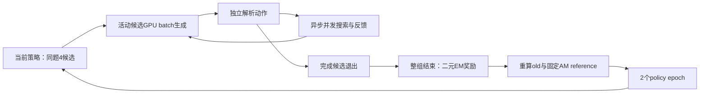

# 0.8B最终实验：批量异步采样与在线GRPO

本轮固定AM seed42-A父模型、现有128条训练轨迹、128道评价题及训练/开发混合索引。实现与实验从2026-10-12 00:58:08（北京时间）开始计时，24小时截止；新训练截止提前2小时。最终结果保存在`runs/final-online-grpo-20261012/results/REPORT.md`，以实际完成量为准。

## 实现亮点

`TransformersModelClient.generate_batch(requests, batch_seed, policy_version)`将活动轨迹组成一次真实GPU生成。每行独立保存JSON/EOS停止位置、真实action token、左padding mask、上下文、采样seed和策略版本；生成及带padding的logprob重放使用相同的位置编号。单条生成接口继续供最终评价使用。

工具反馈通过`asyncio.gather`并发执行，各轨迹的查询、历史、结束原因独立。现有MiniLM编码器保留线程锁，编码前向仍串行；批量GPU生成与工具任务并发分别记录实际收益。

同一组全部完成后才更新参数，下一组使用更新后的策略重新采样。reference始终为初始AM LoRA快照；仅assistant action token进入损失，问题及工具反馈只提供条件上下文。每条轨迹等权，轨迹内按action token数加权，使用clip=0.2、KL=0.02、学习率5e-6、梯度裁剪1。全对/全错组按零方差跳过更新，并保留其真实轨迹。

## 固定对照

| 分支 | 执行量 |
|---|---|
| AM串行基线 | 128题greedy评价 |
| AM batch4效率 | 同128题，活动候选逐轮退出，记录答案变化与吞吐 |
| AM继续SFT seed42 | 原128条完整轨迹1遍，128次更新，最终串行评价128题 |
| AM在线GRPO seed42 | 128组×4候选，2个policy epoch，最多256次更新，最终串行评价128题 |
| AM在线GRPO seed43 | 独立从相同AM重载，执行同样配置并最终串行评价128题 |
| 原始裸0.8B | 所有上述实验结束后，adapter=None，同配置串行greedy评价128题 |

评价以自然104题EM/F1为主，并列全部128题及24道构造单跳题。128题已暴露，配对区间描述这组题的变化；本轮没有新增语义审核。SFT和GRPO计算量不同，报告实际采样量、更新数与耗时。两个RL seed表示同一AM起点上的优化随机性。

输入/输出上限16384/2048，thinking关闭，每题最多4次模型调用、3次搜索；BM25与MiniLM双路各20候选，RRF k=60，返回3篇。采样显式使用temperature=1、top-p=1、top-k=0、repetition penalty=1。最终评价固定greedy，不挑选中间checkpoint。

## 运行与交付

入口为`scripts/run_final_online_grpo.py`；`scripts/launch_final_autodl.sh`记录本次远端路径，使用`/root/miniconda3/bin/python`。训练每16次SFT更新/16个完整GRPO组保存adapter、optimizer、RNG、顺序和计数；失败保留现场。`scripts/summarize_final_online_grpo.py`从账本计算四分支、配对变化、效率、训练曲线和两条实测简历表述。

`scripts/run_final_autodl.sh`负责时限、归档及关机：结束后生成归档与SHA256，等待本地取回确认最多15分钟，随后执行AutoDL官方`/usr/bin/shutdown`。`scripts/collect_final_autodl.ps1`下载、校验、解包后发送确认。

用户追加裸模型比较后，`scripts/launch_final_bare_after.sh`接管最后收尾；原关机包装器暂停，GPU主实验继续运行。新监督器等待原实验完全退出，再运行`evaluate_final_bare.py`，随后生成综合指标及报告并归档关机。总时限仍按最初实施时间计算。

综合指标还包含best-alias token precision/recall、回答完成率、各类终止原因、模型/工具延迟分位数、调用与token分布、现有标注支持文档的召回和最终可见覆盖、GRPO奖励分布/有效组比例/KL/clip比例/梯度/ratio/loss。缺少日志或标注的指标注明NA，保持原始分母；不新增语义审核或模型调用。

首次启动的评分字段兼容遗漏已修正；该次未完成基线保存在结果目录的`implementation-attempt-1`，不纳入正式四分支或效率对比。修复后从头执行正式基线，保持完整实测耗时。
