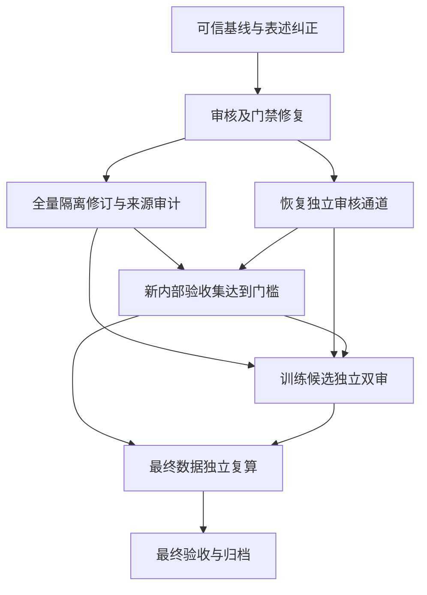

# v128 数据实验准备 Goal

用户已手动恢复本 Goal。**最新权威状态（2026-09-27）：G0–G3 passed，G4 blocked，G5–G7 waiting；**G3 passed 只证明独立审核通道可安全返回有效票，不证明候选集合格。G2 passed 仅表示隔离/修订/未配对库存的去重处置已逐项闭合，不表示修订获得语义批准或可训练。一次新内部池已冻结100题/200状态，但Luna没有完整批准配对，故无法作为验收集；一次性建池预算已消耗。数据尚不能进入既定实验。未启动训练、模型生成、GPU实例或远端电源操作。

## v130 当前权威进展（2026-09-27）

一次性新池预算已消耗：按固定规则筛查 5,000 个未暴露来源题，冻结 100 题/200 状态/100 严格配对；独立重放确认来源隔离、配对、BM25 top-3 与 tokenizer 预算。冻结只证明可复算，不代表语义合格。隔离 Luna 盲审完成 200 状态：原始票否决全部 100 个搜索动作、98 个答案动作；完成一次仅改引用 document_id 的机械更正后，有效票为搜索85条否决、答案93条否决和2条批准，另20条引用无法机械绑定而排除。没有完整批准配对，故风险交集为空。盲审的主要发现是 linked-title 查询会从文本中选到与问题缺失关系无关的标题。该池是 CPU 诊断脚手架和官方答案候选，不是模型轨迹或模型准确率证据；不得训练、调参、重复审核、重筛或扩池。

DeepSeek `g4-batch-01` 有一个结果未知请求，永久禁止重发；`g4-batch-02` 两次 HTTP 200 均耗尽 16,000 reasoning tokens、返回空正文，唯一技术更正后仍无有效票；批次03–10未发送。Runner 已增加对空/截断响应的立即停止保护并有离线回归测试。附件调用汇总只到 2026-09-26，不能核对 9 月 27 日可能产生的费用。当前 Goal 调度结果为 G0–G2 passed、G3 blocked、G4–G7 waiting、next=null；`training_allowed=false`、`data_ready_for_experiment=false`。详细证据见 [v130 冻结集重放](../data/evidence-sft-v124-forensic/goal-v128/g4-frozen-replay-audit-v130-private.json)、[盲审处置](../data/evidence-sft-v124-forensic/goal-v128/g4-blind-review-disposition-v130-private.json)、[质量诊断](../data/evidence-sft-v124-forensic/goal-v128/g4-new-pool-review-diagnosis-v130-private.md) 与 [DeepSeek 调用核账](../data/evidence-sft-v124-forensic/goal-v128/g4-deepseek-accounting-audit-v130-private.json)。本节为当前权威状态；下文相关 G3/G4 阶段记录保留为当时快照。

## v131 DeepSeek 通道复核（2026-09-27）

用户确认 DeepSeek 凭据已配置于工作区父目录 `.env`；runner 已确认能读到凭据且主机配置为 `https://api.deepseek.com`，没有显示或保存密钥。复核发现 v130 请求漏传 thinking 开关，而 DeepSeek Chat Completions 文档规定 thinking 默认开启；v130-batch-02 的16,000 completion tokens全耗于reasoning，空正文是请求配置造成的，不能归因为凭据缺失。Runner现固定 `thinking: {type: disabled}`、`max_tokens: 8192`，并在新批次清单里记录请求配置；空/截断答复仍立即停止。官方说明见 [Chat Completions API](https://api-docs.deepseek.com/api/create-chat-completion/)。

离线runner回归测试7项通过。随后仅对冻结包中此前未发送的 `g4-batch-03` 做了一次独立20状态请求，调用最终记录为结果未知、未收到HTTP响应、无有效票；该批次不得重发。此新结果既不能证明修正后的响应配置失败，也不能证明审核通道可用。runner现会在未知调用日志中只记录异常类型和系统错误码，不记录请求正文或凭据。之后一次只读认证 `GET /models` 也返回本地 `URLError`、未收到HTTP响应，说明当前本机网络路径未证实可用，但不能由此推断批次03在服务端的处理状态。费用导出仍只到9月26日，无法核对此次调用可能产生的费用。G3继续阻断，G4候选池仍因Luna有效双审批准配对为零而失败；完整记录见 [v131通道诊断](../data/evidence-sft-v124-forensic/goal-v128/g3-post-fix-channel-diagnostic-v131-private.json)。`training_allowed=false`、`data_ready_for_experiment=false`。

## v132 通道恢复与候选质量复核（2026-09-27）

进一步网络检查确认：Python环境配置的HTTPS代理TCP连接被拒绝（errno 10061），但直连官方API域名的TLS握手成功；不带密钥的直连 `GET /models` 返回预期401。Runner增加显式 `--direct-connection`，默认代理行为不变。另发现v129提示未明确禁止答案动作引用问题文本，也未充分强调短的逐字证据引用；`g4-small-01` 两个响应均未通过机械引用校验，唯一格式更正已用尽，该包永久不重发。新v130引用契约明确这些规则，并有反例回归测试；旧v129包与票据仍绑定旧哈希。

从此前未向DeepSeek发送的冻结批次04中，按固定顺序取第二个完整题对构造两状态 `g4-small-02`，与所有此前DeepSeek请求题目ID不重叠。v130契约、关闭reasoning、直连及单次请求返回了两张有效票；两状态均被否决，引用逐字可复算。对题面与票据复核显示，答案缺少动作前证据；搜索查询“Mugby Junction”偏离题目所缺事实，搜索本身仍必要。票据的搜索原因里“redundant”措辞与 `search_needed=yes` 有轻微表述冲突，因此此处只作为通道验证和诊断，绝不算候选通过或训练标签。DeepSeek与Luna的全池交集仍为零完整批准题对。

故G3现可通过：已验证凭据配置不泄露、DeepSeek Flash身份与协议绑定、未知结果不重发、单次技术更正上限，以及Luna隔离审核包的匿名来源边界。G4应阻断：本次唯一授权的新池100题/200状态/100配对的Luna有效批准仅两个答案状态且不构成完整配对；所有有效搜索票均否决，剩余20票因引用不可绑定而无效。风险配额和50题验收集不可达；不能通过重审否决或扩充已耗尽候选预算补齐。要尝试新内部池需另行明确授权。完整G3证据见 [v132诊断](../data/evidence-sft-v124-forensic/goal-v128/g3-channel-diagnostic-v132-private.json)。聚焦测试36项通过；`training_allowed=false`、`data_ready_for_experiment=false`。

## 当前进度（2026-09-27）

| 项目 | 当前证据 | 结论 |
|---|---|---|
| 主审覆盖 | progress.json 为 1229/1229 | 主审完成不等于每条双审通过 |
| v117 保留核心 | 228 状态、150 题、12 个严格配对 | 旧票精确复用与主审保留仍需在最终验收复核 |
| v122 双审补充 | 50 状态、25 题、25 个严格配对 | 局部补充门槛通过 |
| 合并候选 | 278 状态、175 题、37 配对 | 距 395/211/100 仍缺 117/36/63 |
| v123 新内部集 | 旧报告按旧规则曾记21个完整双审题组；v130按严格v129机械复核42个等价映射后为19组 | 旧票据结果不等于新审核；19组的双审风险交集为关系13、时间6、范围2、测量2，仍不足门槛 |
| 隔离数据 | 120条仍有各自隔离原因；修订候选不等于解除隔离 | 继续逐ID修复或有据排除 |
| v126 修订包 | 32状态/16组，准备状态 | 没有增加有效双审训练标签 |
| v127 Fred Meyer | 2状态重放，Luna一名审核者批准两状态 | 缺第二独立票，仍隔离 |

权威入口：`data/evidence-sft-v124-forensic/progress.json`、`train-core-candidate-preflight-private.json`、`double-reviewed-v122-supplement-preflight-private.json`、`v127-fred-meyer-quarantine-replay-report-private.json`，以及 `data/evidence-sft-v123/internal/insufficiency-certificate.json`。当前 `training_allowed=false`。

G0 已从原始冻结训练行及具名审核、lineage、修订材料复算：保留答案轨迹中162个搜索动作/工具结果位置，12个与现有搜索目标状态相同，150个前缀不同；仅10个有合格答案引用联结，且10个都未做语义审核。旧临时匹配器的零匹配结论作废。构造器按官方 supporting-facts 选择检索能补足标注事实的查询，因此这些是 oracle-assisted 程序轨迹，不是模型生成轨迹。[G0复核报告](../data/evidence-sft-v124-forensic/goal-v128/g0-baseline-report-private.md)。

G0 逐行确认核心228条中217条来自v114双审、11条来自v116；当前报告的四类风险数190/91/46/20完全来自v114双审批准标签的交集。那11条v116记录没有非空 provisional 风险标签，没有贡献风险配额。这个结果纠正了旧备注对核心风险来源的过度保留；最终格式与语义门禁仍未完成，也没有新的模型正确率或端到端成绩。G0 还发现 v117 的“345状态、186题、75组”是从 v116 旧 preflight 继承的布尔检查；它不是在 v117 冻结行上重算出的严格配对数。

G0 审计范围有一项偏差：一次 `rg` 命令递归搜索了 `reports` 目录，结果包含 `reports/v115-private-run/batches/*.jsonl` 原始开发记录。该输出未用于本基线的计数证据。命令没有搜索 `data` 目录，也没有按路径打开封存测试文件；但无法证明报告目录不存在封存材料副本。后续只对具名白名单文件操作，并在最终交付中保留此限制。

## 子目标与依赖

每个子目标的工作、禁止事项和逐项验收条件都在 `data/evidence-sft-v124-forensic/goal-v128/plan.json`。这是一个原生 Goal 调度本地子目标图，不宣称平台提供多个独立原生 subgoal API，也没有另建对话或后台服务。

## 自动推进方式

在仓库目录执行 `python -m scripts.v128_goal_workflow next`，读取 `goal-v128/next-prompt.md`，执行选中的子目标。执行者逐项检查真实证据后，提交带来源哈希、验收人、每项证明和依赖验收票哈希的 receipt；运行 `python -m scripts.v128_goal_workflow accept --receipt <仓库内相对路径>`。

调度器验证完整性后自动选取下一个前置条件通过的子目标并生成提示词；由当前原生 Goal 继续执行。证据或前置票发生变化，会撤销相应验收状态并阻断下游。失败/阻断不会被当成完成，也不会无变化地自动重试；其他独立ready节点仍可继续。每版receipt保存在history目录，中断后可恢复。

调度器只能验证文件、哈希及依赖，不能从布尔值推断语义正确。独立审核者仍须实际审阅证据，两张票也不构成“绝无任何语义错误”的数学保证。最终要求是入选样本没有已知未解决矛盾、无格式错误、无单审/争议/无效票，并真正达到既定数量、风险和隔离门槛。

## 必须保留的边界

- 不读取或扫描封存集，不启动模型生成、训练、GPU或电源操作；不恢复费用记账。
- 隔离数据可以修复或有据排除。无法修复的条目继续隔离，不能为了“全部处理完”把坏样本救回。
- 已耗尽的单次候选池预算不能通过自动化重置。若现有材料仍不可达，先交付不足证书和具体新设计，等待明确新范围授权；不能降低门槛。
- 审核通道凭据缺失或未知调用未对账时，不重复发送。不能用主审代替第二票或换未经授权模型。
- 最后只有真实数据门禁通过才能设 `data_ready_for_experiment=true`。`training_allowed`仍保持false，数据准备Goal不授权启动训练。

G0 本地复核已完成并记录验收票。G1 修复并冻结了供未来审核包使用的 v128 引用/时点契约，增加旧协议失败例回归测试，复算了当前主审核引用的机械绑定，并对278条现有训练候选做了本地 tokenizer 长度回放。主审记录的机械引用检查无错误，不等于语义双审；token 长度通过也不等于数据合格或训练有效。旧 v114–v127 票据没有改写或按新契约重新解释，也没有发送新审核请求。当前状态仍为 `training_allowed=false`、`data_ready_for_experiment=false`。详见 [G1 审计报告](../data/evidence-sft-v124-forensic/goal-v128/g1-audit-report-private.md) 与 `goal-v128/review-contract-v1.json`。

G1 收据通过工作流校验后，调度进入 G2。下一步只处理已列明库存的逐ID来源/修订审计，不扩池、不重新提交相同审核，也不把修订候选视为已批准训练数据。G0 的范围偏差仍按其报告保留：不得声称已证明绝对未接触任何封存内容。

G2/G3 本地推进记录（2026-09-27）：G2 将120条隔离状态、63条v117未决标记和61条CPU重放状态按record ID复算为234个不同状态；另有35个未成对来源题。v117的107条repair candidates已逐ID拆解为61条backlog repair状态与另46条CPU reconciliation repair状态，交集为0，并与具名trainability snapshot一致。首版G2报告曾误称107无法映射，因漏查该快照；更正与逐ID清单见 [G2报告](../data/evidence-sft-v124-forensic/goal-v128/g2-repair-audit-report-private.md) 和 `goal-v128/g2-repair-inventory-private.json`。G2仍因107条候选来源/动作时点链未全部闭合、缺有效独立双审而blocked；机械重放不等于修订完成。

G3对旧修订审核日志复算发现4组中有3个DeepSeek请求最终仍未知，另1组在一次技术更正后无效；没有重发。此前“SSH认证未通过”的文字已过时：使用已配置 `autodl_ed25519` 后，只读 `pwd`/`whoami` 成功，远端身份为 `root`；但这不证明DeepSeek API端点或审核者身份。远端旧v123归档不能匹配这3个未知请求。另发现此前漏入G3清单的 `pending-dual-review-v9`：3批55状态有单一DeepSeek票（49批准、6否决），另有一次20状态的引文更正；按G2清单交叉后仅43条是v117 repair候选，另12条为隔离/retain状态，其中1条精确重复当前训练状态。没有新增双审批准，batch-02的7个主审分歧状态继续hold。该日志系统的manifest未更新审核标记、未记录API host，batch-01初始票也未通过当前validator复放。详见 [G3通道状态](../data/evidence-sft-v124-forensic/goal-v128/g3-review-channel-report-private.md) 与 [v9请求复算](../data/evidence-sft-v124-forensic/goal-v128/g3-v9-request-audit-private.json)。本轮六个内嵌搜索Luna票仍是单审诊断；case-04漏引动作前证据且理由与可见文档矛盾，原票保留并排除。冻结v128校验器的否决票引用缺口已用单独前向v129实现和测试修正，但未提交新审核。G2、G3仍阻断，当前无ready子目标、数据或训练授权。

## 最新 G2/G3/G4 独立核账（2026-09-27）

使用一名无历史上下文的隔离 GPT-6 Luna 审核者，对v9原有55个匿名状态补做独立逐状态意见；一次引用技术更正已保留首轮原始票。55票当前逐字引用结构均通过，但与旧DeepSeek票按更严格搜索引用口径交叉后，43条repair中33条两票同为批准，其中1条仍在旧主审分歧hold，余32条只是**暂定交叉批准**。另有12条旧DeepSeek搜索票不满足当前严格引用约束；因发送时validator哈希和API host均缺失，既不倒改历史票，也不能据它们宣称审核通道身份已核验。没有状态获得训练授权；见 [Luna票据复核](../data/evidence-sft-v124-forensic/goal-v128/g2-luna-v9-independent-review-audit-private.json) 和 [交叉票复核](../data/evidence-sft-v124-forensic/goal-v128/g2-v9-independent-vote-crosscheck-private.json)。

变更查询重建审计只找到1条结构上可能接到既有答案状态的链接，但历史v117运行器版本未与冻结样本绑定，实际重建、token回放和语义批准仍为0；另外8条没有严格匹配的同组答案后缀。35道未成对题的旧“重放/改写”是主审分诊，不是轨迹；诊断构造器使用supporting-fact标注挑选查询，未保存模型生成轨迹，因此不再对不存在的动作配对发起双审。修订和未配对核验均记录于 [G2审计报告](../data/evidence-sft-v124-forensic/goal-v128/g2-repair-audit-report-private.md)。

G4前置预算复算确认v123已用完一次性5,000来源筛查和100新题候选预算；既有票据上界49组、范围2条、测量4条，仍达不到50组和每类至少5条。该结果只证明冻结流程在旧票据规则下不足，不证明题源本身没有合格题。后续新池的纠错设计已列入 [G4范围方案](../data/evidence-sft-v124-forensic/goal-v128/g4-next-scope-design-private.md)，未获新的来源范围授权前不启动。当前 G0/G1 passed，G2/G3 blocked，G4–G7等待依赖；`training_allowed=false`、`data_ready_for_experiment=false`。

## 新池授权进展（2026-09-27）

用户已授权一次新池。来源范围按本地溯源唯一选定为 v114 快照中的官方 HotpotQA `distractor/train`（90,447题、两个校验通过的分片）；v123先前筛过的5,000个ID及全部可用历史ID/规范化题面将排除。预算仍是最多检查5,000题、最多100个候选、一次语料冻结，题面读取导致的重复/拒绝也计入5,000上限。范围、哈希和预算口径见 [新池范围记录](../data/evidence-sft-v124-forensic/goal-v128/g4-new-pool-scope-v124-private.json)、[口径更正](../data/evidence-sft-v124-forensic/goal-v128/g4-new-pool-scope-correction-private.json) 与 [授权/暂缓报告](../data/evidence-sft-v124-forensic/goal-v128/g4-new-pool-authorization-and-stop-report-private.md)。

截至授权记录时只锁定来源范围，尚未读取新来源题面。后续在已暴露v123前100题上对非oracle标题后续查询做了离线诊断：94题检索到新文档，但只有12题补入尚缺的精确官方支持句，首轮加后续结果仅19题覆盖全部支持句。该结果不是正确率，但证明“新文档”不能作有用证据的替代指标。故v130在筛查前停止；新池本轮消耗0/5,000题面、0/100候选、0次审核调用、0次语料冻结。旧v123构造仍是oracle-assisted程序轨迹，不是模型搜索行为。详见 [G4 v130方法阻断报告](../data/evidence-sft-v124-forensic/goal-v128/g4-new-pool-method-blocker-v130-private.md)、[支持句诊断](../data/evidence-sft-v124-forensic/goal-v128/g4-query-policy-exposed-support-diagnostic-private.json) 与 [旧票v129复算](../data/evidence-sft-v124-forensic/goal-v128/g4-v123-reuse-v129-audit-v2-private.json)。

## 当前收敛状态（2026-09-27，覆盖本文件中较早的“当前状态”叙述）

`python -m scripts.v128_goal_workflow next` 当前复算为 G0/G1/G2/G3 `passed`、G4 `blocked`、G5/G6/G7 `waiting_dependencies`、`next=null`。G2 的通过票见 `goal-v128/receipts/G2.json`：107个repair候选分为70个有具体理由排除、37个仅机械准备后续语义审查；新增双审批准和严格配对均为0，120隔离状态继续hold，35未配对题仍仅诊断。G3通过票见 `goal-v128/receipts/G3.json`：前向DeepSeek审核运行器和隔离审核流程可用，但未发送任何新审核请求；历史未知/无效票不恢复、不重发。两票的通过不能推导训练候选或内部集通过。

G4阻断收据为 `goal-v128/receipts/G4.json`。在已检查的v117 frozen/review、v116 staged/diagnostic、v121/v122具名资产中，没有找到可直接构成未暴露新内部集的真实模型轨迹；该目录核查不构成对整个工作区的绝对不存在证明。v121冻结包仅含内部语料、内部任务和manifest；v122 run记录是既有四组固定状态及开发probe。没有打开任何 final-test 或独立100题内容。要继续G4，必须先有能在禁生成边界内忠实构造未暴露审核状态的方法，或用户明确修改该边界并认可替代方案；在此之前不得消耗一次性新池预算。`training_allowed=false`、`data_ready_for_experiment=false`。
