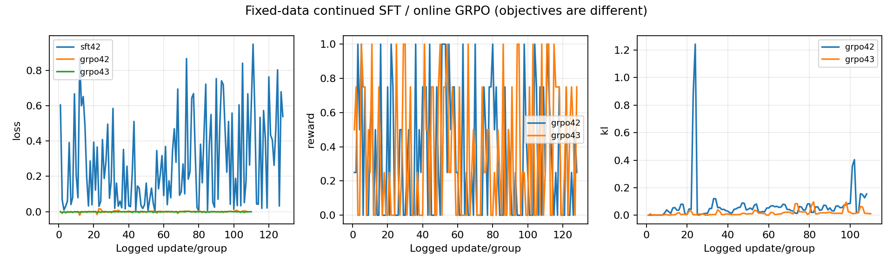

# 固定0.8B：继续SFT与在线GRPO最终结果

本轮仅使用现有训练材料及已暴露128题；下列是EM/F1与机械指标，没有新的语义审核或独立泛化结论。
SFT与GRPO从同一个AM42-A父模型起步；两个RL seed验证追加训练，不代表整条历史训练链双seed复现。裸0.8B额外评价，不参与训练。

四臂及裸模型128题结果：完成。

## natural104（预定104题）

| 分支 | 已完成 | 严格EM | 归一化EM | F1 | 回答完成 | 调用/搜索 | 平均/P95秒 |
|---|---:|---:|---:|---:|---:|---:|---:|
| am-serial | 104/104 | 47 | 47 | 0.591 | 102 (98.1%) | 313/209 | 4.855/6.033 |
| sft42 | 104/104 | 49 | 49 | 0.585 | 102 (98.1%) | 313/209 | 4.896/6.269 |
| grpo42 | 104/104 | 40 | 40 | 0.507 | 104 (100.0%) | 291/187 | 4.203/5.620 |
| grpo43 | 104/104 | 46 | 46 | 0.585 | 103 (99.0%) | 304/200 | 4.505/5.952 |

| 比较 | 完整配对 | 新增/丢失 | EM差值百分点 | 配对95%区间 |
|---|---:|---:|---:|---:|
| sft42 vs AM | 104/104 | 7/5 | 1.92 | [-4.81, 8.65] |
| grpo42 vs AM | 104/104 | 4/11 | -6.73 | [-14.42, 0.00] |
| grpo43 vs AM | 104/104 | 6/7 | -0.96 | [-7.69, 5.77] |
| grpo42 vs SFT | 104/104 | 2/11 | -8.65 | [-15.38, -2.88] |
| grpo43 vs SFT | 104/104 | 5/8 | -2.88 | [-9.62, 3.85] |

## all128（预定128题）

| 分支 | 已完成 | 严格EM | 归一化EM | F1 | 回答完成 | 调用/搜索 | 平均/P95秒 |
|---|---:|---:|---:|---:|---:|---:|---:|
| am-serial | 128/128 | 66 | 67 | 0.647 | 125 (97.7%) | 371/243 | 4.662/6.029 |
| sft42 | 128/128 | 67 | 68 | 0.645 | 126 (98.4%) | 375/247 | 4.748/6.235 |
| grpo42 | 128/128 | 60 | 61 | 0.587 | 128 (100.0%) | 339/211 | 3.960/5.451 |
| grpo43 | 128/128 | 65 | 66 | 0.648 | 127 (99.2%) | 358/230 | 4.284/5.988 |

| 比较 | 完整配对 | 新增/丢失 | EM差值百分点 | 配对95%区间 |
|---|---:|---:|---:|---:|
| sft42 vs AM | 128/128 | 8/7 | 0.78 | [-5.47, 7.03] |
| grpo42 vs AM | 128/128 | 5/11 | -4.69 | [-10.94, 1.56] |
| grpo43 vs AM | 128/128 | 7/8 | -0.78 | [-7.03, 5.47] |
| grpo42 vs SFT | 128/128 | 4/11 | -5.47 | [-10.94, 0.00] |
| grpo43 vs SFT | 128/128 | 6/8 | -1.56 | [-7.03, 4.69] |

## single24（预定24题）

| 分支 | 已完成 | 严格EM | 归一化EM | F1 | 回答完成 | 调用/搜索 | 平均/P95秒 |
|---|---:|---:|---:|---:|---:|---:|---:|
| am-serial | 24/24 | 19 | 20 | 0.889 | 23 (95.8%) | 58/34 | 3.822/5.899 |
| sft42 | 24/24 | 18 | 19 | 0.901 | 24 (100.0%) | 62/38 | 4.106/5.865 |
| grpo42 | 24/24 | 20 | 21 | 0.931 | 24 (100.0%) | 48/24 | 2.907/3.319 |
| grpo43 | 24/24 | 19 | 20 | 0.922 | 24 (100.0%) | 54/30 | 3.328/5.899 |

| 比较 | 完整配对 | 新增/丢失 | EM差值百分点 | 配对95%区间 |
|---|---:|---:|---:|---:|
| sft42 vs AM | 24/24 | 1/2 | -4.17 | [-16.67, 8.33] |
| grpo42 vs AM | 24/24 | 1/0 | 4.17 | [0.00, 12.50] |
| grpo43 vs AM | 24/24 | 1/1 | 0.00 | [-12.50, 12.50] |
| grpo42 vs SFT | 24/24 | 2/0 | 8.33 | [0.00, 20.83] |
| grpo43 vs SFT | 24/24 | 1/0 | 4.17 | [0.00, 12.50] |

## 裸0.8B与现有训练链对比

裸模型使用同一题集、语料、greedy及调用预算，直接加载基础权重而不加载LoRA；不是新增训练分支。

| 集合 | 裸模型已完成 | 严格/归一化EM | F1 | 完成回答 |
|---|---:|---:|---:|---:|
| natural104 | 104/104 | 0/0 | 0.000 | 0 |
| all128 | 128/128 | 0/0 | 0.000 | 0 |
| single24 | 24/24 | 0/0 | 0.000 | 0 |

| 裸模型→分支 | 集合 | 完整配对 | 新增/丢失 | EM差值百分点 | 配对95%区间 |
|---|---|---:|---:|---:|---:|
| am-serial | natural104 | 104/104 | 47/0 | 45.19 | [35.58, 54.81] |
| sft42 | natural104 | 104/104 | 49/0 | 47.12 | [37.50, 56.73] |
| grpo42 | natural104 | 104/104 | 40/0 | 38.46 | [29.81, 48.08] |
| grpo43 | natural104 | 104/104 | 46/0 | 44.23 | [35.58, 53.85] |
| am-serial | all128 | 128/128 | 67/0 | 52.34 | [43.75, 60.94] |
| sft42 | all128 | 128/128 | 68/0 | 53.12 | [44.53, 61.72] |
| grpo42 | all128 | 128/128 | 61/0 | 47.66 | [39.06, 57.03] |
| grpo43 | all128 | 128/128 | 66/0 | 51.56 | [42.97, 60.16] |
| am-serial | single24 | 24/24 | 20/0 | 83.33 | [66.67, 95.83] |
| sft42 | single24 | 24/24 | 19/0 | 79.17 | [62.50, 95.83] |
| grpo42 | single24 | 24/24 | 21/0 | 87.50 | [75.00, 100.00] |
| grpo43 | single24 | 24/24 | 20/0 | 83.33 | [66.67, 95.83] |

## 训练与资源

| 分支 | 采样轨迹 | 实际组/更新 | 零方差组 | 训练秒 | 峰值reserved GiB |
|---|---:|---:|---:|---:|---:|
| sft42 | 0 | 0/128 | 0 | 233.425 | 13.475 |
| grpo42 | 512 | 128/108 | 74 | 1882.711 | 17.992 |
| grpo43 | 512 | 128/110 | 73 | 1909.855 | 15.859 |

GRPO每seed最多128组、每组最多2次策略更新；SFT一遍128次更新。名义题数相同不表示计算量相同，零方差组可能没有更新。

## batch4效率对照

| 路径 | 计时覆盖 | wall秒 | 题/分钟 | 输入/输出token每秒 | allocated/reserved GiB |
|---|---:|---:|---:|---:|---:|
| serial | 128 (full evaluation) | 604.111 | 12.713 | 365.049/10.761 | 1.916/2.035 |
| batch | 128 (full evaluation) | 217.341 | 35.336 | 1020.331/29.925 | 2.875/4.305 |

batch/serial吞吐比：2.780；同题答案文本变化6/128。
吞吐使用实际进程wall时间；batch各题重叠耗时不相加作wall。若续跑，速度只覆盖该进程完成的题段。效率对照不与主质量四臂混算。

## 简历可用实际值

- 在固定0.8B模型与现有128条训练材料上完成继续SFT及在线GRPO双seed比较；已暴露104道自然多跳题上，裸模型归一化EM 0/104，AM 47/104，SFT 49/104，GRPO seed42 40/104; seed43 46/104。
- 实现在线真实搜索采样及训练/评价账本；固定AM的串行/batch4实测吞吐12.713→35.336题/分钟，吞吐比2.780，峰值reserved显存2.035→4.305GiB；128个配对题答案文本变化6题。

逐题新增/丢失与配对F1区间见summary.json。保留全部结果，不按评价分选择seed或回改训练配方。

[完整机械质量、效率、检索覆盖与训练指标](comprehensive-metrics.md)；[机器可读指标](comprehensive-metrics.json)。这些指标由现有账本派生，不增加模型调用或语义审核。
